# 案例索引：课件图例与新增研究案例

当前收录 **16 条有课件缩略图的案例观察**（CASE-0001–0016）与 **1 条待上传原图的词云信息图研究条目**（CASE-0017）。词云条目由用户于 2026-11-23 指定新增；已补充数据字段、字号映射、统计/艺术排版区分与核验清单，但尚无对应案例原图及原始词频数据；下一新增案例编号从 CASE-0018 继续。

| 图例缩略图 | ID | 来源页 | 案例 | 主要逻辑 | 主要表现 |
| --- | --- | --- | --- | --- | --- |
| 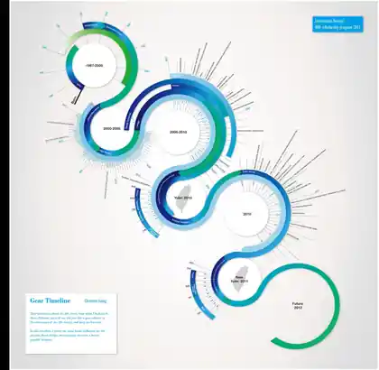 | [CASE-0001](案例记录/CASE-0001-编年曲线.md) | 3 | 编年曲线 | 编年 | [类型](03-时间轴型信息图形-Timeline.md) |
| 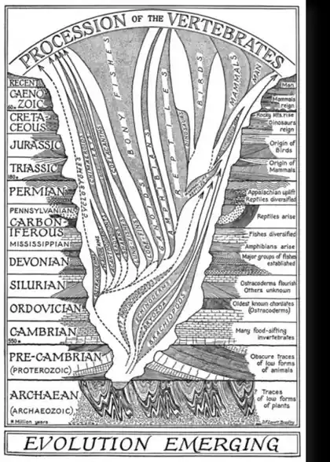 | [CASE-0002](案例记录/CASE-0002-进化层级图.md) | 6 | 进化层级图 | 层级 | [类型](09-层级表现型-Hierarchical.md) |
| 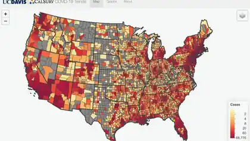 | [CASE-0003](案例记录/CASE-0003-美国疫情地图.md) | 9 | 美国疫情地图 | 地理 | [类型](07-地标型-Location.md) |
| 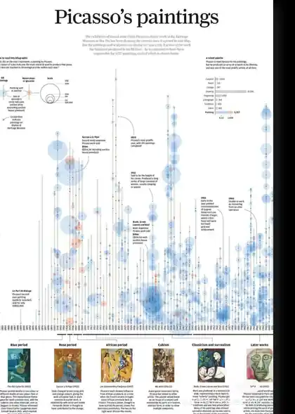 | [CASE-0004](案例记录/CASE-0004-绘画编目.md) | 11 | 绘画编目 | 编目 | [类型](01-混合型信息图形-Mixed-Charts.md) |
| 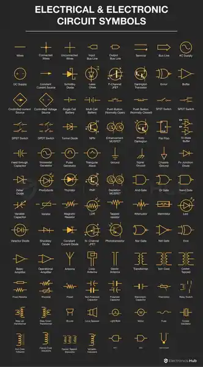 | [CASE-0005](案例记录/CASE-0005-电路符号图鉴.md) | 14 | 电路符号图鉴 | 编目 | [类型](02-文字型与列表型信息图形-Informational-List.md) |
| 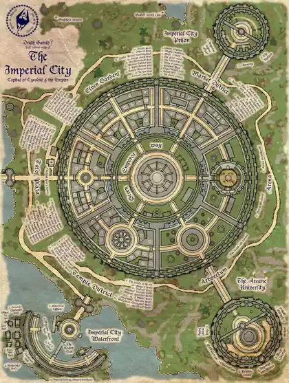 | [CASE-0006](案例记录/CASE-0006-城市空间规划图.md) | 17 | 城市空间规划图 | 地理 | [类型](07-地标型-Location.md) |
| 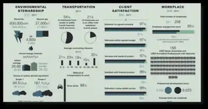 | [CASE-0007](案例记录/CASE-0007-多主题混合统计.md) | 22 | 多主题混合统计 | 编目 | [类型](01-混合型信息图形-Mixed-Charts.md) |
| 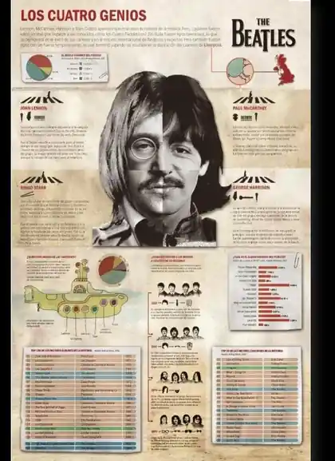 | [CASE-0008](案例记录/CASE-0008-人物文字列表.md) | 23 | 人物文字列表 | 编目 | [类型](02-文字型与列表型信息图形-Informational-List.md) |
| 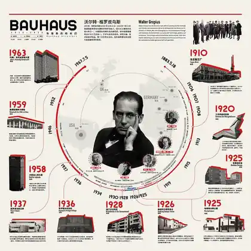 | [CASE-0009](案例记录/CASE-0009-包豪斯时间轴.md) | 24 | 包豪斯时间轴 | 编年 | [类型](03-时间轴型信息图形-Timeline.md) |
| 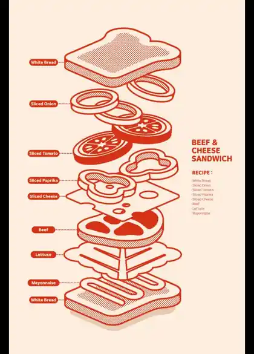 | [CASE-0010](案例记录/CASE-0010-分层三明治.md) | 25 | 分层三明治 | 层级 | [类型](04-示意图型-How-to.md) |
| 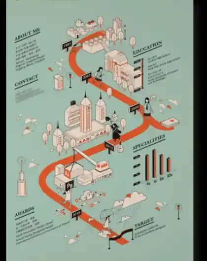 | [CASE-0011](案例记录/CASE-0011-城市流程路线.md) | 26 | 城市流程路线 | 编年 | [类型](05-流程图型-Process.md) |
| 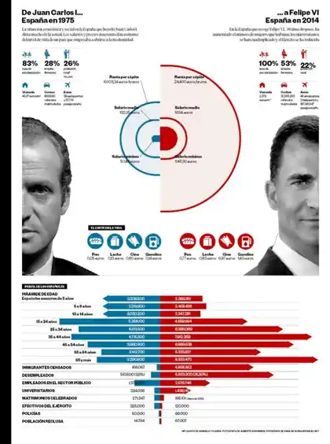 | [CASE-0012](案例记录/CASE-0012-体育人物比较.md) | 27 | 体育人物比较 | 编目 | [类型](06-比较型-Comparison.md) |
| 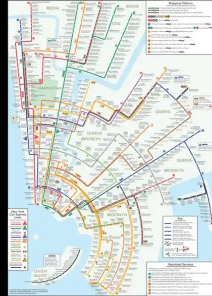 | [CASE-0013](案例记录/CASE-0013-轨道交通网络.md) | 28 | 轨道交通网络 | 地理 | [类型](07-地标型-Location.md) |
| 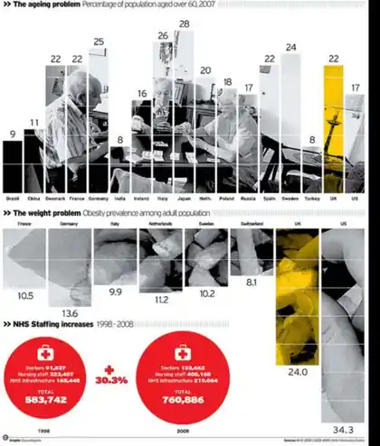 | [CASE-0014](案例记录/CASE-0014-摄影嵌入图表.md) | 29 | 摄影嵌入图表 | 编年 | [类型](08-图片式-Photographic.md) |
| 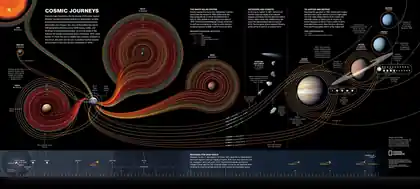 | [CASE-0015](案例记录/CASE-0015-宇宙旅程混合图.md) | 37 | 宇宙旅程混合图 | 编年 | [类型](15-编年编目混合图-Chronological-Catalog.md) |
| 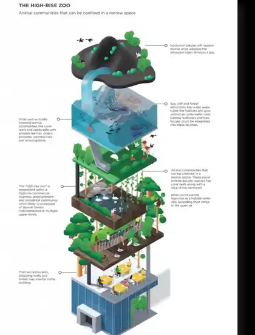 | [CASE-0016](案例记录/CASE-0016-轴测分层生态图.md) | 38 | 轴测分层生态图 | 层级 | [类型](16-三维信息图形-3D.md) |
| *暂无原图/词频数据* | [CASE-0017](11-可视化文本型-Visualized-Text.md#case-0017-词云信息图word-cloud-infographic) | 用户指定（2026-11-23） | 词云信息图 Word Cloud | 编目（暂定） | [17 词云信息图](17-词云信息图-Word-Cloud-Infographic.md)（可视化文本型） |

**证据提醒**：CASE-0001–0016 是课件图片的初步视觉观察。CASE-0017 尚未获得实际词云图片，仅是待检验的研究条目，不应当作已完成图例分析。新增资料将直接更新本索引和原有类型文档，不新建 Markdown。课件图像的独立转载/商业授权未核实；01 数据逻辑目录仍不存图片。

[课件核验](课件来源与分类核验.md) · [方法指南](信息图形研究方法与质量评估.md) · [案例模板](案例分析模板.md)
